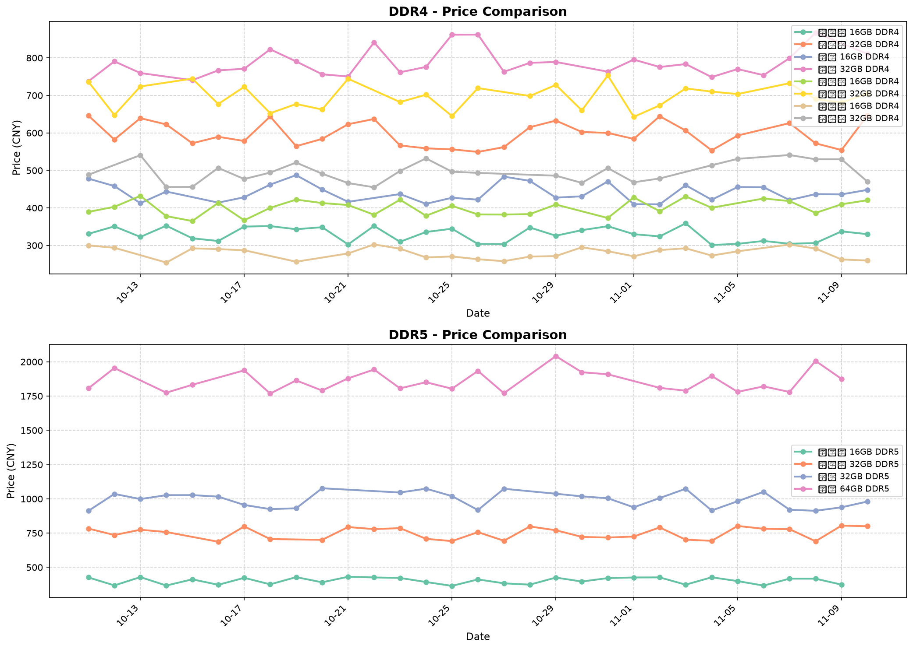
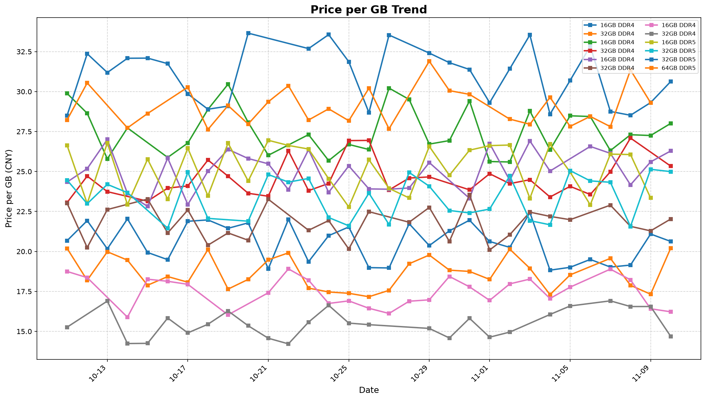

# 📊 京东内存价格监控

自动追踪京东内存价格变化，每日更新两次。

## 📈 产品价格

| 产品 | 容量 | 类型 | 当前价格 | 历史最低 |
|------|------|------|----------|----------|
| 金士顿 FURY | 16GB | DDR4 3200MHz | ¥329 | ¥299 |
| 金士顿 FURY | 32GB | DDR4 3200MHz | ¥599 | ¥549 |
| 芝奇 幻光戟 | 16GB | DDR4 3600MHz | ¥449 | ¥399 |
| 芝奇 幻光戟 | 32GB | DDR4 3600MHz | ¥799 | ¥699 |
| 海盗船 复仇者 | 16GB | DDR4 3600MHz | ¥399 | ¥359 |
| 海盗船 复仇者 | 32GB | DDR4 3600MHz | ¥699 | ¥629 |
| 英睿达 | 16GB | DDR4 2666MHz | ¥279 | ¥249 |
| 英睿达 | 32GB | DDR4 2666MHz | ¥499 | ¥449 |
| 金百达 银爵 | 16GB | DDR5 6000MHz | ¥399 | ¥359 |
| 金百达 银爵 | 32GB | DDR5 6000MHz | ¥749 | ¥679 |
| 芝奇 焰锋戟 | 32GB | DDR5 6000MHz | ¥999 | ¥899 |
| 芝奇 焰锋戟 | 64GB | DDR5 6000MHz | ¥1899 | ¥1699 |

---

## 📊 价格趋势图

### 产品价格对比

### 每GB价格趋势

---

## 🔄 自动更新

每天北京时间 10:00 和 20:00 自动更新价格。

## 📁 数据格式

历史数据存储在 `data/YYYY-MM-DD.json` 文件中。

---

*数据仅供参考，以京东实际价格为准*
