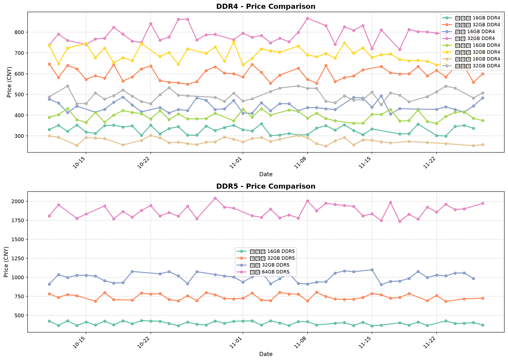
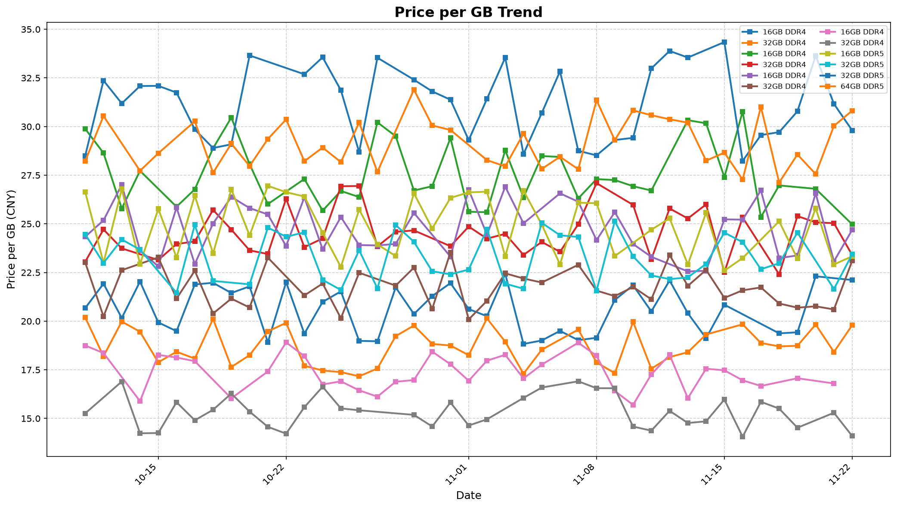

# 📊 京东内存价格监控

自动追踪京东内存价格变化，每日更新两次。

## 📈 产品价格

| 产品 | 容量 | 类型 | 当前价格 | 有货 |
|------|------|------|----------|------|
| 金士顿 16GB DDR4 | 16GB | DDR4 | ¥345.78 | ✅ |
| 金士顿 32GB DDR4 | 32GB | DDR4 | ¥630.94 | ✅ |
| 芝奇 16GB DDR4 | 16GB | DDR4 | ¥427.37 | ✅ |
| 芝奇 32GB DDR4 | 32GB | DDR4 | ¥793.06 | ✅ |
| 海盗船 16GB DDR4 | 16GB | DDR4 | ¥413.72 | ✅ |
| 海盗船 32GB DDR4 | 32GB | DDR4 | ¥741.10 | ✅ |
| 英睿达 16GB DDR4 | 16GB | DDR4 | - | ❌ |
| 英睿达 32GB DDR4 | 32GB | DDR4 | ¥530.36 | ✅ |
| 金百达 16GB DDR5 | 16GB | DDR5 | ¥392.26 | ✅ |
| 金百达 32GB DDR5 | 32GB | DDR5 | - | ❌ |
| 芝奇 32GB DDR5 | 32GB | DDR5 | ¥1056.61 | ✅ |
| 芝奇 64GB DDR5 | 64GB | DDR5 | ¥1890.16 | ✅ |

---

## 📊 价格趋势图

### 产品价格对比

### 每GB价格趋势

---

## 🔄 自动更新

每天北京时间 10:00 和 20:00 自动更新价格。

## 📁 数据格式

历史数据存储在 `data/YYYY-MM-DD.json` 文件中。

---

*数据仅供参考，以京东实际价格为准*